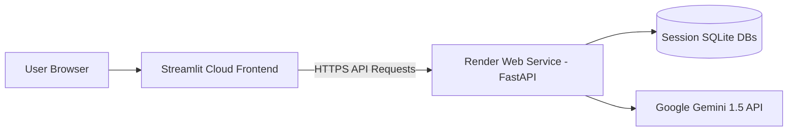

# NaturalSQL: Comprehensive Audit, Loopholes & Deployment Plan

**Project:** NaturalSQL  
**Status:** Feature Complete (MVP)  
**Evaluation:** The project has an elegant architecture, clean UI styling, isolated session management, and solid foundational design. However, there are **critical functional loopholes**, **security vulnerabilities**, and **deployment blockers** that must be resolved before deploying to production.

---

## 1. Executive Summary & Readiness Score

| Category | Score | Status | Key Notes |
| :--- | :--- | :--- | :--- |
| **UI / UX Design** | 9/10 | Excellent | Clean dark aesthetic, custom CSS, chart auto-render, chat bubbles. |
| **Core SQL Generation** | 7/10 | Needs Work | Table names are missing in prompt; CTEs (`WITH`) rejected. |
| **Data Engine & Storage** | 5/10 | Critical Bugs | `.db` upload is broken; Windows URI path issue; disk usage OS bug. |
| **Security & Concurrency**| 6/10 | Vulnerabilities| Path traversal risk; global Gemini key race condition; no request timeouts. |
| **Cloud Deployability** | 4/10 | Blocked | Hardcoded `127.0.0.1:8000`; relative module import failures. |

---

## 2. Critical Bugs & Functional Loopholes (Must-Fix)

### 🔴 Loophole 1: `.db` File Upload is Completely Broken
* **File:** [`backend/database.py`](file:///d:/study/PROJECTS/project_3/NaturalSQL/backend/database.py#L36-L57) & [`backend/routes.py`](file:///d:/study/PROJECTS/project_3/NaturalSQL/backend/routes.py#L17)
* **Problem:** In [`backend/routes.py`](file:///d:/study/PROJECTS/project_3/NaturalSQL/backend/routes.py), `ALLOWED_EXTENSIONS` includes `.db`, and Streamlit allows `.db` uploads. However, in [`database.py`](file:///d:/study/PROJECTS/project_3/NaturalSQL/backend/database.py):
  ```python
  def create_sqlite_database(file_path: str, session_id: str):
      ...
      if file_path.endswith(".csv"):
          ...
      elif file_path.endswith(".xlsx"):
          ...
  ```
  If a user uploads a `.db` file, neither condition is met. The code connects to a new `{session_id}.db` file (creating an **empty** database), ignores the uploaded database, and returns schema with **zero tables**.
* **Impact:** Any user uploading a SQLite database gets an empty schema and cannot run any queries.
* **Fix:** Add a branch for `.db` files: if the uploaded file is `.db`, copy it to `{session_id}.db` (or rename/validate it).

---

### 🔴 Loophole 2: Prompt Builder Drops Table Names and Hardcodes `FROM data`
* **File:** [`backend/llm/prompt_builder.py`](file:///d:/study/PROJECTS/project_3/NaturalSQL/backend/llm/prompt_builder.py#L5-L25)
* **Problem:** 
  1. The schema extractor in [`database.py`](file:///d:/study/PROJECTS/project_3/NaturalSQL/backend/database.py#L65-L76) extracts:
     `{"table": table_name, "name": col_name, "type": col_type}`
  2. But [`prompt_builder.py`](file:///d:/study/PROJECTS/project_3/NaturalSQL/backend/llm/prompt_builder.py) ignores `col['table']`:
     ```python
     schema_text = "\n".join([f"{col['name']} ({col['type']})" for col in schema])
     ```
  3. And the prompt explicitly instructs Gemini:
     `Rules: - Use table name data`
* **Impact:** 
  - For Excel files with multiple sheets (where each sheet becomes its own table) or `.db` files with tables (e.g., `customers`, `orders`), the LLM does not know which column belongs to which table.
  - The LLM generates `SELECT ... FROM data`, which immediately fails with `sqlite3.OperationalError: no such table: data`.
  - Multi-table queries and JOINs are impossible.
* **Fix:** Group the schema by table name in the prompt:
  ```text
  Table 'orders':
    - order_id (INTEGER)
    - amount (REAL)
  Table 'customers':
    - customer_id (INTEGER)
    - name (TEXT)
  ```
  And change the rule to: `Use the exact table and column names provided in the schema above.`

---

### 🔴 Loophole 3: Relative Module Imports Break When Running from Workspace Root
* **Files:** [`backend/main.py`](file:///d:/study/PROJECTS/project_3/NaturalSQL/backend/main.py#L2), [`backend/routes.py`](file:///d:/study/PROJECTS/project_3/NaturalSQL/backend/routes.py#L6-L13), [`backend/sql_service.py`](file:///d:/study/PROJECTS/project_3/NaturalSQL/backend/sql_service.py#L2-L3)
* **Problem:**
  - In `backend/main.py`: `from routes import router`
  - In `backend/routes.py`: `from database import ...`
  - In `backend/sql_service.py`: `from llm.prompt_builder import ...`
  If you run the standard production command from the repository root:
  ```bash
  uvicorn backend.main:app
  ```
  Python throws `ModuleNotFoundError: No module named 'routes'`. It currently only works if you `cd backend` first.
* **Impact:** Render, Docker, and standard deployment platforms will fail to start the server unless working directories are specifically patched.
* **Fix:** Use package imports (e.g., `from backend.routes import router` or dynamically add `backend` to `sys.path` in `main.py`).

---

### 🔴 Loophole 4: Hardcoded `BASE_URL = "http://127.0.0.1:8000"` in Frontend
* **File:** [`frontend/api_client.py`](file:///d:/study/PROJECTS/project_3/NaturalSQL/frontend/api_client.py#L5)
* **Problem:** `BASE_URL` is hardcoded to `http://127.0.0.1:8000`.
* **Impact:** When deployed to Streamlit Community Cloud, the browser/cloud instance will attempt to connect to its own `127.0.0.1:8000`, causing instant connection failure for every upload and query.
* **Fix:** Allow `BASE_URL` to be configured from an environment variable or `st.secrets`:
  ```python
  import os
  import streamlit as st

  BASE_URL = os.getenv("BACKEND_URL") or st.secrets.get("BACKEND_URL", "http://127.0.0.1:8000")
  ```

---

### 🔴 Loophole 5: Windows Path URI Failure in `execute_query`
* **File:** [`backend/database.py`](file:///d:/study/PROJECTS/project_3/NaturalSQL/backend/database.py#L83-L84)
* **Problem:**
  ```python
  uri = f"file:{db_path}?mode=ro"
  conn = sqlite3.connect(uri, uri=True, check_same_thread=False)
  ```
  On Windows, `db_path` contains backslashes (e.g., `uploads\session_id\session_id.db`). In URI syntax, backslashes are invalid, which can cause `sqlite3.OperationalError: unable to open database file`.
* **Impact:** Fails in local Windows environments or Windows-based self-hosted runners.
* **Fix:** Convert to absolute path with forward slashes or use `pathlib.Path(db_path).resolve().as_uri() + "?mode=ro"`.

---

### 🔴 Loophole 6: Overly Restrictive SQL Validation Disallows Common Table Expressions (WITH)
* **File:** [`backend/sql_service.py`](file:///d:/study/PROJECTS/project_3/NaturalSQL/backend/sql_service.py#L7-L20)
* **Problem:**
  1. `if not query_upper.strip().startswith("SELECT"):`
     Blocks valid SQL queries starting with `WITH` (Common Table Expressions - CTEs), which Gemini frequently outputs for complex aggregations and rankings.
  2. `re.search(rf'\b{keyword}\b', query_upper)` for keywords like `UPDATE`, `DROP`, `DELETE`.
     If a user has a column named `status` with value `'UPDATE'` or `'DELETE'` (e.g. `SELECT * FROM logs WHERE action = 'DELETE'`), the regex marks the query as unsafe and blocks execution.
* **Impact:** Legitimate analytical queries fail with false positive security warnings.
* **Fix:** Allow queries starting with `SELECT` or `WITH`. Since SQLite is already opened in read-only mode (`?mode=ro`), runtime write attacks are already mitigated at the engine level.

---

### 🔴 Loophole 7: Fragile Markdown Code Fence Stripping
* **File:** [`backend/sql_service.py`](file:///d:/study/PROJECTS/project_3/NaturalSQL/backend/sql_service.py#L38)
* **Problem:**
  `cleaned_sql = generated_sql.replace("```sql", "").replace("```", "").strip()`
  If Gemini adds conversational text around the block:
  ```text
  Here is the query:
  ```sql
  SELECT * FROM data;
  ```
  This is useful because...
  ```
  The string replacement leaves the conversational text in `cleaned_sql`, which breaks the query validator and crashes the SQL engine.
* **Fix:** Use regex extraction:
  ```python
  match = re.search(r"```(?:sql)?\s*(.*?)\s*```", generated_sql, re.DOTALL | re.IGNORECASE)
  cleaned_sql = match.group(1).strip() if match else generated_sql.strip()
  ```

---

### 🔴 Loophole 8: Inconsistent Disk Usage Check
* **File:** [`backend/database.py`](file:///d:/study/PROJECTS/project_3/NaturalSQL/backend/database.py#L14)
* **Problem:** `shutil.disk_usage("/")` checks the system root drive (often `C:\` on Windows), even if the workspace and uploads are located on drive `D:\` or an attached mount.
* **Fix:** Use `shutil.disk_usage(os.path.abspath(UPLOAD_DIR))`.

---

## 3. Security & Concurrency Vulnerabilities

### ⚠️ Security 1: Path Traversal in File Uploads & Session IDs
* **File:** [`backend/database.py`](file:///d:/study/PROJECTS/project_3/NaturalSQL/backend/database.py#L29) & [`backend/routes.py`](file:///d:/study/PROJECTS/project_3/NaturalSQL/backend/routes.py#L42)
* **Issue:** 
  `file_path = os.path.join(session_dir, file.filename)`
  If a malicious user submits a crafted `file.filename` (e.g. `../../etc/passwd` or `../app.py`), or a manipulated `session_id` like `../../var`, files can be written or read outside the designated session folder.
* **Mitigation:**
  - Sanitize filename using `os.path.basename(file.filename)`.
  - Validate that `session_id` matches a strict UUIDv4 regex (`^[a-f0-9\-]{36}$`).

---

### ⚠️ Security 2: Concurrency Race Condition in `genai.configure()`
* **File:** [`backend/llm/gemini_provider.py`](file:///d:/study/PROJECTS/project_3/NaturalSQL/backend/llm/gemini_provider.py#L9)
* **Issue:** `genai.configure(api_key=api_key)` mutates global state across the entire Python process. In a deployed multi-user environment, if User A and User B send queries simultaneously, User A's API key can be overwritten mid-flight by User B's key, using each other's quota.
* **Mitigation:**
  Pass the client explicitly or use client instances:
  ```python
  from google.generativeai import client
  # or pass api_key directly into GenerativeModel if supported in SDK
  ```
  Or create a localized client wrapper instance per request.

---

### ⚠️ Security 3: Unbounded Memory Consumption & Large Query DoS
* **File:** [`backend/database.py`](file:///d:/study/PROJECTS/project_3/NaturalSQL/backend/database.py#L44-L88)
* **Issue:** 
  1. If a user uploads a 100MB CSV with millions of rows, `pd.read_csv` and `df.to_sql` can consume 1GB+ RAM in pandas. Render Free Tier only provides 512MB RAM, causing an instant `OOMKilled` (out-of-memory crash).
  2. If a query returns 500,000 rows, `df.to_dict(orient="records")` serializes the entire dataset into memory as a JSON response, freezing both FastAPI and Streamlit.
* **Mitigation:**
  - Cap query result rows (e.g., append or enforce `LIMIT 1000` or slice `df.head(1000)`).
  - Enforce a lower max file upload size for free cloud tier (e.g. 25MB-50MB).

---

### ⚠️ Security 4: Missing CORS Middleware
* **File:** [`backend/main.py`](file:///d:/study/PROJECTS/project_3/NaturalSQL/backend/main.py)
* **Issue:** There is no `CORSMiddleware` configured. While Streamlit calls the backend server-to-server via Python `requests`, having CORS configured is essential if you ever add web clients, Swagger UI testing, or custom widgets.

---

### ⚠️ Security 5: Missing HTTP Timeouts on Frontend Requests
* **File:** [`frontend/api_client.py`](file:///d:/study/PROJECTS/project_3/NaturalSQL/frontend/api_client.py)
* **Issue:** `requests.post()` calls do not specify a `timeout` parameter. If Render backend is sleeping (cold start takes 50–90 seconds on free tier) or hangs, Streamlit threads will freeze indefinitely.
* **Mitigation:** Add `timeout=120` to all `requests.post` calls, with user-friendly error messages explaining cold-starts.

---

## 4. High-Impact UX & Feature Enhancements

1. **Download Query Results as CSV / Excel:**
   - In [`frontend/streamlit_app.py`](file:///d:/study/PROJECTS/project_3/NaturalSQL/frontend/streamlit_app.py#L199-L206), add `st.download_button` so users can export their filtered/aggregated data.
2. **Editable SQL Query:**
   - Currently, users can only preview the generated SQL. Giving them an option to edit the SQL in a text box before clicking "Run Query" makes the app 10x more useful for data analysts.
3. **Follow-up Chat Memory:**
   - The LLM currently receives only the current question and schema. Incorporating previous questions/SQL queries into the prompt will enable conversational refinement (e.g., *"Now show only top 5"* or *"Group that by month"*).
4. **Backend Health Check & Cold-Start Banner:**
   - Render free tier puts apps to sleep after 15 minutes of inactivity. When a user opens Streamlit, display a small indicator showing whether the backend is awake or warming up.

---

## 5. Step-by-Step Deployment Guide

We will deploy using the **Industry-Standard Decoupled Architecture**:
- **Backend (FastAPI):** Hosted on **Render** (Free Tier Web Service).
- **Frontend (Streamlit):** Hosted on **Streamlit Community Cloud** (Free Tier).



---

### Step 1: Pre-Deployment Code Fixes (Checklist)

Before pushing to GitHub, make these essential adjustments:
- [ ] Fix package imports in `backend/main.py` and `backend/routes.py`.
- [ ] Make `BASE_URL` in `frontend/api_client.py` read from `os.getenv("BACKEND_URL")` or `st.secrets["BACKEND_URL"]`.
- [ ] Fix `.db` file handling in `backend/database.py`.
- [ ] Fix table name inclusion in `backend/llm/prompt_builder.py`.
- [ ] Add `python-dotenv` and `gunicorn` (optional, for Linux process management) to `requirements.txt`.
- [ ] Ensure `.gitignore` ignores `uploads/` and local `.db` files.

---

### Step 2: Prepare Repository Configuration Files

Create the following files in the repository root:

1. **`Procfile`** (for platforms like Render / Railway / Heroku):
   ```text
   web: uvicorn backend.main:app --host 0.0.0.0 --port $PORT
   ```

2. **`render.yaml`** (optional, enables 1-click Blueprint deployment on Render):
   ```yaml
   services:
     - type: web
       name: naturalsql-backend
       env: python
       region: oregon
       plan: free
       buildCommand: pip install -r requirements.txt
       startCommand: uvicorn backend.main:app --host 0.0.0.0 --port $PORT
       envVars:
         - key: PYTHON_VERSION
           value: 3.11.9
   ```

---

### Step 3: Deploy Backend to Render

1. **Sign Up / Log In:** Go to [render.com](https://render.com) and link your GitHub account.
2. **Create New Web Service:**
   - Click **New +** -> **Web Service**.
   - Select your `NaturalSQL` repository.
3. **Configure Settings:**
   - **Name:** `naturalsql-backend`
   - **Region:** Choose the closest region (e.g., Oregon or Frankfurt).
   - **Branch:** `main`
   - **Root Directory:** *(Leave blank to keep project root)*
   - **Runtime:** `Python 3`
   - **Build Command:** `pip install -r requirements.txt`
   - **Start Command:** `uvicorn backend.main:app --host 0.0.0.0 --port $PORT`
   - **Instance Type:** `Free`
4. **Deploy:** Click **Create Web Service**.
5. **Verify:**
   - Wait 2–3 minutes for the build to finish.
   - Render will generate a public URL, for example: `https://naturalsql-backend.onrender.com`.
   - Open `https://naturalsql-backend.onrender.com/` in your browser. You should see:
     ```json
     {"status": "running", "service": "NaturalSQL Backend"}
     ```

---

### Step 4: Deploy Frontend to Streamlit Community Cloud

1. **Sign Up / Log In:** Go to [share.streamlit.io](https://share.streamlit.io) and log in with your GitHub account.
2. **Create New App:**
   - Click **Create App**.
   - Select your repository: `mayanksingh05/NaturalSQL`
   - **Branch:** `main`
   - **Main file path:** `frontend/streamlit_app.py`
3. **Configure App Secrets:**
   - Click **Advanced settings...** before deploying (or go to App Settings -> Secrets after creation).
   - In the secrets text box, add the backend URL from Step 3:
     ```toml
     BACKEND_URL = "https://naturalsql-backend.onrender.com"
     ```
4. **Deploy:** Click **Deploy!**
5. **Verify:**
   - Streamlit will install dependencies from `requirements.txt` and launch the app.
   - You will receive a clean public URL like `https://naturalsql.streamlit.app`.

---

### Step 5: Post-Deployment Smoke Testing & Verification

Run through this test sequence once deployed:
1. **Health Check:** Confirm Streamlit loads without errors.
2. **CSV Upload:** Upload a sample CSV (e.g. `sales.csv`). Verify schema tables and columns appear in sidebar.
3. **Query Generation:** Input Gemini API key and prompt: `"Show total sales by category"`. Check generated SQL.
4. **Query Execution:** Click **Run Query**. Confirm data table and Plotly chart render correctly.
5. **Excel Multi-sheet Test:** Upload a multi-sheet `.xlsx` file and ask questions across sheets.
6. **Session Isolation:** Open an Incognito window, verify that the second user gets a unique session ID and cannot see the first user's tables or files.

---

## 6. Action Matrix & Resolution Status

| Status | Priority | Task | File(s) | Impact / Resolution |
| :---: | :---: | :--- | :--- | :--- |
| ✅ Fixed | 🚨 P0 | Support configurable `BACKEND_URL` | [`frontend/api_client.py`](file:///d:/study/PROJECTS/project_3/NaturalSQL/frontend/api_client.py) | Dynamic URL from env / secrets with localhost fallback |
| ✅ Fixed | 🚨 P0 | Fix module imports for `uvicorn backend.main:app` | [`backend/main.py`](file:///d:/study/PROJECTS/project_3/NaturalSQL/backend/main.py), [`backend/routes.py`](file:///d:/study/PROJECTS/project_3/NaturalSQL/backend/routes.py) | Added automatic `sys.path` injection |
| ✅ Fixed | 🚨 P0 | Include table names in prompt & drop `Use table name data` | [`backend/llm/prompt_builder.py`](file:///d:/study/PROJECTS/project_3/NaturalSQL/backend/llm/prompt_builder.py) | Schema grouped by table; supports Excel sheets & JOINs |
| ✅ Fixed | 🚨 P0 | Fix `.db` file handling & multi-sheet Excel creation | [`backend/database.py`](file:///d:/study/PROJECTS/project_3/NaturalSQL/backend/database.py) | Fully supports CSV, Excel (.xlsx, .xls), and SQLite (.db) |
| ✅ Fixed | 🚨 P0 | Exclusively provide "Bring Your Own Key" UI | [`frontend/streamlit_app.py`](file:///d:/study/PROJECTS/project_3/NaturalSQL/frontend/streamlit_app.py) | Removed disabled premium toggle, added key guidance & link |
| ✅ Fixed | ⚠️ P1 | Add regex code block extraction | [`backend/sql_service.py`](file:///d:/study/PROJECTS/project_3/NaturalSQL/backend/sql_service.py) | Cleanly isolates SQL from any introductory/closing commentary |
| ✅ Fixed | ⚠️ P1 | Allow `WITH` clauses & refine keyword check | [`backend/sql_service.py`](file:///d:/study/PROJECTS/project_3/NaturalSQL/backend/sql_service.py) | Supports CTEs and prevents false positives on data values |
| ✅ Fixed | ⚠️ P1 | Add request timeouts & cold-start error handling | [`frontend/api_client.py`](file:///d:/study/PROJECTS/project_3/NaturalSQL/frontend/api_client.py) | Added 90s timeout and clear Render cold-start user feedback |
| ✅ Fixed | ⚠️ P1 | Fix cross-platform SQLite URI path parsing | [`backend/database.py`](file:///d:/study/PROJECTS/project_3/NaturalSQL/backend/database.py) | Uses `Path.resolve().as_uri()` for Windows and Linux compatibility |
| ✅ Fixed | 💡 P2 | Add CSV export button | [`frontend/streamlit_app.py`](file:///d:/study/PROJECTS/project_3/NaturalSQL/frontend/streamlit_app.py) | One-click CSV download for query results |
| ✅ Fixed | 💡 P2 | Add tables and columns schema viewer in sidebar | [`frontend/streamlit_app.py`](file:///d:/study/PROJECTS/project_3/NaturalSQL/frontend/streamlit_app.py) | Users can see what tables & columns are indexed |
